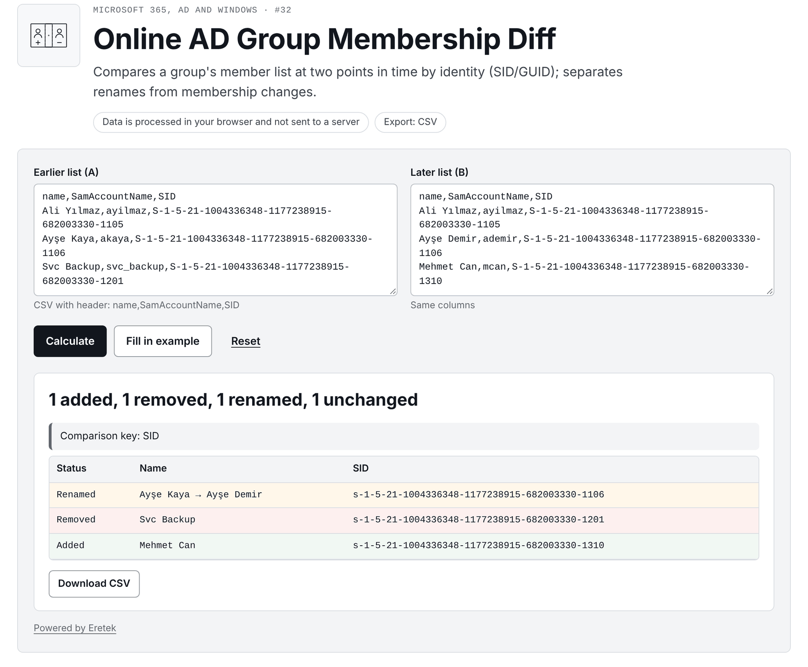

# AD Group Membership Diff

Compare two AD group membership CSVs by SID or objectGUID: added, removed and renamed members. For privileged group reviews.

## Try it live

- [Türkçe](https://sistem.eretek.com/araclar/ad-grup-uyeligi-karsilastirma)
- [English](https://sistem.eretek.com/en/tools/ad-group-membership-diff)
- [Deutsch](https://sistem.eretek.com/de/werkzeuge/ad-gruppenmitglieder-vergleich)



## What it does

Compares a group's member list at two points in time by identity (SID/GUID); separates renames from membership changes.

Membership of privileged groups such as Domain Admins should be reviewed regularly. Comparing lists by name shows a person whose surname changed as 'removed + added' and hides the real change. The tool compares by SID (or objectGUID, or sAMAccountName).

## Where it helps

Treat unexpected additions as security events; search the time in the Windows security log for event IDs 4728/4732/4756 (Windows Event XML Viewer).

## How to use it

1. Export before and after lists: `Get-ADGroupMember 'Domain Admins' | select name,SamAccountName,SID | ConvertTo-Csv -NoTypeInformation`.
2. Paste both lists and press Calculate.

### Fields

| Field | Description |
|---|---|
| Earlier list (A) | CSV with header: name,SamAccountName,SID |
| Later list (B) | Same columns |

## Example input

Press **Fill in example** in the tool to load this input.

**Earlier list (A)**

```text
name,SamAccountName,SID
Ali Yılmaz,ayilmaz,S-1-5-21-1004336348-1177238915-682003330-1105
Ayşe Kaya,akaya,S-1-5-21-1004336348-1177238915-682003330-1106
Svc Backup,svc_backup,S-1-5-21-1004336348-1177238915-682003330-1201
```

**Later list (B)**

```text
name,SamAccountName,SID
Ali Yılmaz,ayilmaz,S-1-5-21-1004336348-1177238915-682003330-1105
Ayşe Demir,ademir,S-1-5-21-1004336348-1177238915-682003330-1106
Mehmet Can,mcan,S-1-5-21-1004336348-1177238915-682003330-1310
```

**Expected result:** 1 added (Mehmet Can), 1 removed (svc_backup), 1 renamed (Ayşe Kaya → Ayşe Demir, same SID), 1 unchanged.

## Method and assumptions

The key column is chosen as SID → objectGUID → SamAccountName; both lists must use the same kind. Comparison is case-insensitive.

Keys only in A are removed, only in B added, present in both with a different name/sAMAccountName renamed.

## Limits and common mistakes

- Nested groups are not expanded; use a list exported with `-Recursive` to include indirect members.
- Names of foreign security principals (FSP) are not resolved.

## Run it locally

The tool is plain HTML, CSS and JavaScript with no build step and no dependencies.

```bash
git clone https://github.com/eretek/ad-group-membership-diff.git
cd ad-group-membership-diff
node scripts/serve.js        # or: python3 -m http.server 8080
```

Open <http://127.0.0.1:8080/>. Add `?lang=tr` or `?lang=de` for Turkish or German; without it the page follows the browser language and falls back to English. You can also open `index.html` directly from disk.

Run the tests (Node.js 18 or later):

```bash
node test/run.js    # or: npm test
```

The tests run the tool's own fixtures and the worked examples in all three languages without a browser.

## How it works

All processing happens in your browser. The tool makes no network requests, uses no cookies or browser storage, and does not upload files you select.

No server-side component is needed. The version on the Eretek website renders the same page through a private WordPress plugin; that plugin only produces the page markup and is not part of this repository.

| Path | Purpose |
|---|---|
| `index.html` | Page shell |
| `src/app.js` | Builds the page in Turkish, English or German from `src/data.js` |
| `src/data.js` | Field definitions, examples and all texts in three languages |
| `src/core.js` | Shared runtime: validation, number formats, result rendering, CSV/ICS export |
| `src/tool.js` | The calculation or analysis for this tool |
| `docs/screenshot.png` | Screenshot used in this README |
| `src/tools.css`, `src/page.css` | Styles |
| `test/run.js`, `test/cases.json` | Headless tests |

## License and attribution

This tool is released under the [Eretek Website Attribution License](LICENSE). You may use, modify and redistribute it, including commercially. If you make it available on a website or web application, show a visible, clickable credit linking to https://eretek.com/ on every page where the tool is available, for example:

```html
<a href="https://eretek.com/">Powered by Eretek</a>
```

You may add `rel="nofollow"` to the link. Keep the copyright notice and license text in copies and redistributions.
